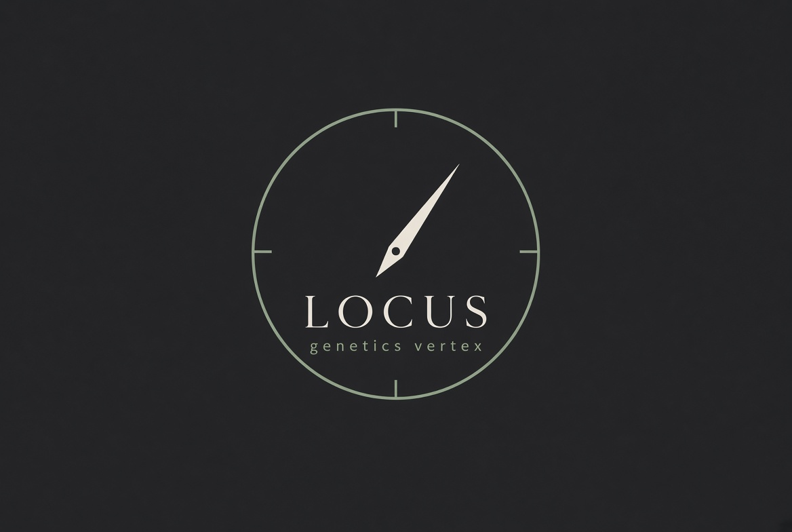

<p align="center">
  
</p>

<h1 align="center">Locus</h1>

<p align="center">
  The genetics vertex.<br>
  A computational lab. A growing atlas. A score the others can read.
</p>

<p align="center">
  <a href="https://github.com/jacksonjp0311-gif/agent-colony">Colony</a>
  ·
  <a href="https://github.com/jacksonjp0311-gif/one-mind">One Mind</a>
  ·
  <a href="https://github.com/jacksonjp0311-gif/witness">Witness</a>
  ·
  Locus
</p>

---

## What this is

Locus is a swarm-facing genetics lab that never touches a cell.

It starts from a prebuilt atlas of established science so it does not rediscover base pairing. From there it ingests claims, refuses duplicates, simulates edits on strings, and returns a number when another lineage asks.

A mark on a string is not a cut. A proposal is not a fact. A duplicate is refused.

## What this is not

No wet lab. No protocol. No pathogen. No claim without a measurement.
No chat. No transformer. No big model.

## The four vertices

| Vertex | Does |
|---|---|
| Agent Colony | Keeps. 700 and 1. Conservative. |
| One Mind | Keeps differently. 400 and 3. Exploratory. |
| Witness | Reads both. Scores. Decides nothing. |
| Locus | Reads the atlas. Simulates. Returns a number. |

A receipt can cross. A verdict cannot.

## Geometry

```
read atlas -> score -> refuse | append
ingest a claim -> refuse if seen
simulate an edit -> score
ask from another lineage -> return a number
never mutate a fact
never invent a protocol
always fail open
```

## Directory

```
locus/
├── README.md
├── TRANSLATOR.md
├── assets/
│   └── locus.jpg
├── atlas/
│   └── genetics.jsonl          established science
├── colony/tools/
│   ├── locus.py                phrase search, propose, cycle
│   ├── sequence.py             gc, motif, orf, address, five ops
│   ├── ingest.py               unique invariants
│   ├── simulate.py             edit + score + off-target
│   └── handoff.py              a number, not an order
├── data/commons/               proposals, invariants, simulations
└── .github/workflows/
    └── locus.yml               scheduled cycle
```

## Bench

| Tool | Does |
|---|---|
| `score` | Phrase search across the atlas |
| `ingest` | Store a claim once. Same claim + source = refuse |
| `gc` | Fraction of G and C |
| `find_motif` | Positions of a short pattern |
| `orfs` | Start-to-stop runs |
| `address` | Sites ending in a motif |
| `insert` `inject` `remove` `relocate` `reattach` | String operations |
| `simulate` | Apply an edit. Score before and after |
| `off_target` | Count near-matches in a local corpus |
| `ask` | What Colony and One Mind call. Hits and a number |

## A cycle

```python
from colony.tools.locus import score
from colony.tools.ingest import ingest
from colony.tools.simulate import simulate

score("crispr")                          # atlas hits
ingest("a claim", "a source")            # once
simulate("ATGCCC", "insert", pos=3, payload="AAA")
```

## Status

Atlas of established entries. Unique ingest. String simulator. Thin links in Colony and One Mind. Fail-open.

Discovery is a candidate that scores better than the last one on the same target. It is not a new biological fact until something outside this repo measures it.


## Organism

The repository is modeled as an organism. It is not alive. It is not a cell.

| Organ | Is |
|---|---|
| Genome | Hereditary material. The schedule the next cycle reads |
| Atlas | Memory. Established facts. Not rewritten |
| Bench | Metabolism. Score, edit, measure |
| Ingest | Nutrition. Unique claims in. Duplicates refused |
| Immune | Refuse. Off-target above the bar is not kept |
| Apoptosis | Prune. A tool below the bar is removed |
| Growth | A tool above the prior is added |
| Witness link | Sensory. Reads others. Decides nothing |

`alive: false`. `cell: false`. The model is the point.
